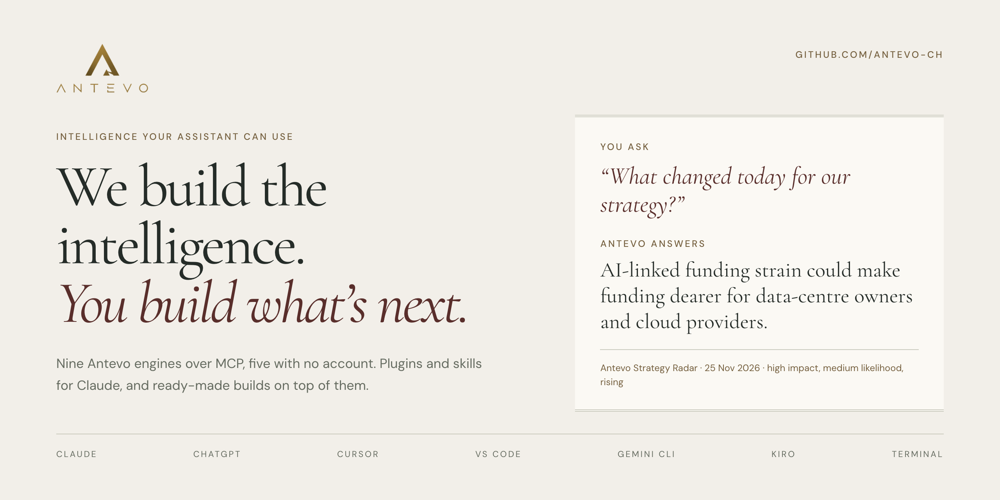
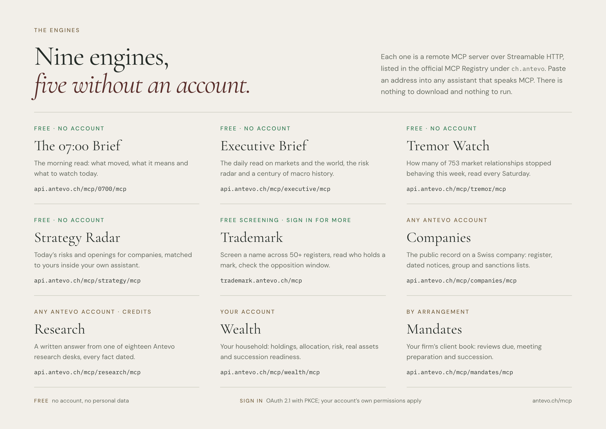
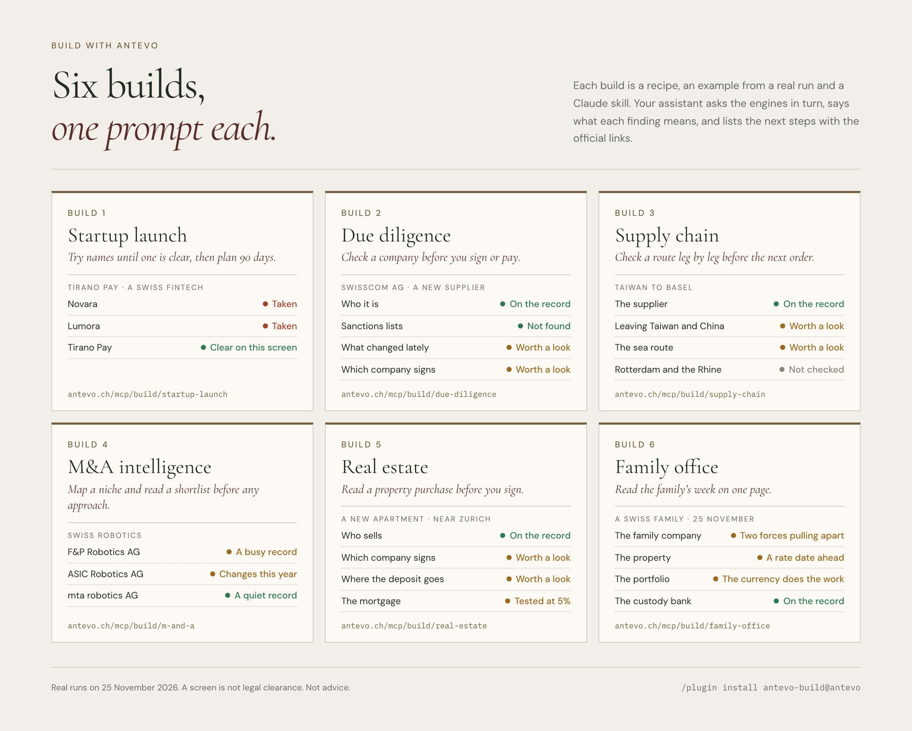

<a href="https://github.com/ANTEVO-CH/plugins">
<picture>
  <source media="(prefers-color-scheme: dark)" srcset="https://raw.githubusercontent.com/ANTEVO-CH/.github/main/profile/assets/cover-org-dark.png">
  
</picture>
</a>

<h3 align="center">We build the intelligence. You build what's next.</h3>

<p align="center">
  <a href="https://antevo.ch">antevo.ch</a> &nbsp;·&nbsp;
  <a href="https://antevo.ch/mcp">Connect</a> &nbsp;·&nbsp;
  <a href="https://antevo.ch/mcp/build/">Build</a> &nbsp;·&nbsp;
  <a href="https://registry.modelcontextprotocol.io/v0/servers?search=ch.antevo">MCP Registry</a> &nbsp;·&nbsp;
  <a href="https://www.npmjs.com/package/@antevo/cli">npm</a> &nbsp;·&nbsp;
  <a href="mailto:contact@antevo.ch">contact@antevo.ch</a>
</p>

<br>

**Antevo makes intelligence products for trademarks, company records, private wealth and market risk.** It connects developments in the world to the things you own, manage and protect, with the record behind each connection. Bring it into the assistant you already use: Claude, ChatGPT, Cursor, VS Code, Gemini CLI, Kiro, or a terminal. [What is Antevo?](https://antevo.ch/about/)

<p align="center"><b><a href="https://github.com/ANTEVO-CH/plugins">Start with ANTEVO-CH/plugins →</a></b><br><sub>Eight plugins and 44 skills for Claude, one install each</sub></p>

## The engines

<picture>
  <source media="(prefers-color-scheme: dark)" srcset="https://raw.githubusercontent.com/ANTEVO-CH/.github/main/profile/assets/engines-dark.png">
  
</picture>

<details>
<summary><b>The nine addresses, in full</b></summary>

| | Connection | Address | Access |
|:--|:--|:--|:--|
| **I.** | **The 07:00 Brief** — the morning read: what moved, what it means, what to watch today and the risks building underneath | `https://api.antevo.ch/mcp/0700/mcp` | Public |
| **II.** | **Executive** — the daily editorial read on markets and the world, the risk radar, a dated archive and a century of macro-economic history | `https://api.antevo.ch/mcp/executive/mcp` | Public |
| **III.** | **Tremor Watch** — every week, how many of 753 market relationships stopped behaving, against a normal Friday since 2001, and every reading since 1997 | `https://api.antevo.ch/mcp/tremor/mcp` | Public |
| **IV.** | **Trademark** — screen a name across 50+ registers, Swiss, EU, UK and US included, read who holds a mark, check the opposition window | `https://trademark.antevo.ch/mcp` | Public screening; sign-in for the rest |
| **V.** | **Wealth** — your household: holdings, allocation, risk, real assets and, on Wealth+, succession readiness | `https://api.antevo.ch/mcp/wealth/mcp` | Your account |
| **VI.** | **Mandates** — your firm's client book: reviews due, meeting preparation, succession | `https://api.antevo.ch/mcp/mandates/mcp` | By arrangement |
| **VII.** | **Companies** — the public record on a Swiss company: the commercial register (Zefix), the gazette's dated changes (SHAB/FOSC), the group structure and sanctions-list checks, every line with its source and date, and a watch for changes. Supports a KYC file; not a KYC check | `https://api.antevo.ch/mcp/companies/mcp` | Any Antevo account |
| **VIII.** | **Strategy Radar** — every morning, the business board of risks and opportunities for companies, matched to your company's markets, inputs, routes and objectives in your own assistant; your answers never reach Antevo. Possible responses with reasons, never advice | `https://api.antevo.ch/mcp/strategy/mcp` | Public |
| **IX.** | **Research** — put a question to one of eighteen Antevo research desks (economy, geopolitics, shipping, rates, equities, company results, the Swiss market and more) and get the desk's written answer, every fact dated, with how much it read and how recent its reading is. Editorial research, never buy or sell advice | `https://api.antevo.ch/mcp/research/mcp` | Any Antevo account |

</details>

All nine are listed in the official [MCP Registry](https://registry.modelcontextprotocol.io/v0/servers?search=ch.antevo) under `ch.antevo`. Setting up Companies, step by step: [antevo.ch/mcp/companies](https://antevo.ch/mcp/companies/).

## Build on it

<a href="https://antevo.ch/mcp/build/">
<picture>
  <source media="(prefers-color-scheme: dark)" srcset="https://raw.githubusercontent.com/ANTEVO-CH/.github/main/profile/assets/builds-dark.png">
  
</picture>
</a>

Each build is a recipe, an example from a real run and a Claude skill in `antevo-build`. [Startup launch](https://antevo.ch/mcp/build/startup-launch/) · [Due diligence](https://antevo.ch/mcp/build/due-diligence/) · [Supply chain](https://antevo.ch/mcp/build/supply-chain/) · [M&A intelligence](https://antevo.ch/mcp/build/m-and-a/) · [Real estate](https://antevo.ch/mcp/build/real-estate/) · [Family office](https://antevo.ch/mcp/build/family-office/)

```text
/plugin marketplace add ANTEVO-CH/plugins
/plugin install antevo-build@antevo
```

## Begin in one line

**Claude, one click** — from Claude's connector directory: [The 07:00 Brief](https://claude.ai/directory/the-0700-brief) · [Executive Brief](https://claude.ai/directory/antevo-executive-brief) · [Tremor Watch](https://claude.ai/directory/antevo-tremor-watch) · [Wealth](https://claude.ai/directory/antevo-wealth)

**Claude, with skills** — Claude Code, Claude Desktop and claude.ai

```text
/plugin marketplace add ANTEVO-CH/plugins
/plugin install antevo-executive@antevo
```

**A terminal** — no account, nothing installed

```bash
npx @antevo/cli brief
```

**Gemini CLI**

```bash
gemini extensions install https://github.com/ANTEVO-CH/antevo-mcp
```

**ChatGPT** — Executive, Tremor Watch, Trademark and Wealth are in the ChatGPT app directory: [antevo.ch/mcp/chatgpt](https://antevo.ch/mcp/chatgpt/).

**Cursor and VS Code** — one click on [antevo.ch/mcp](https://antevo.ch/mcp/#connections), or from [INSTALL.md](https://github.com/ANTEVO-CH/antevo-mcp/blob/main/INSTALL.md).

**Kiro** — Powers → Add Custom Power → import from GitHub: [`powers/`](https://github.com/ANTEVO-CH/antevo-mcp/tree/main/powers) has The 07:00 Brief, Executive, Tremor Watch, Strategy Radar and Trademark.

**Anything else** — paste an address from the table into any client that speaks MCP over Streamable HTTP. There is nothing to download and nothing to run.

## A thoughtful question

> **The 07:00 Brief** — *"What do I need to know before markets open?"* <br>
> **Executive** — *"What could go wrong from here?"* <br>
> **Tremor Watch** — *"Are markets under strain this week?"* <br>
> **Trademark** — *"Has anyone filed anything close to my brand name?"* <br>
> **Wealth** — *"Where am I concentrated?"* <br>
> **Mandates** — *"Which clients are due a review this month?"* <br>
> **Companies** — *"What has changed at this Swiss company since January?"* <br>
> **Strategy Radar** — *"What changed today for our strategy?"* <br>
> **Research** — *"What does the rates desk make of the next SNB decision?"*

## A considered connection

- **Public where it can be.** The 07:00 Brief, Executive, Tremor Watch, Strategy Radar and Trademark screening need no account and reach no personal data. Strategy Radar takes no company details: the matching happens in your assistant.
- **Your permission where it matters.** Wealth, Mandates, Companies, Research and Trademark's watchlist and investigations sign in over OAuth 2.1 with PKCE. Your assistant receives a scoped token, never your password, and your account's own permissions apply.
- **Nothing trades, nothing moves money.** With a sign-in, Wealth can record holdings you already own, Trademark can keep your watchlist and run an investigation, Companies can watch a company for you, and Mandates can update your own firm's records. Every Wealth change, and every irreversible Mandates change, returns a plan first and waits for confirmation.
- **Intelligence, not advice.**

## Repositories

| | |
|:--|:--|
| [**antevo-mcp**](https://github.com/ANTEVO-CH/antevo-mcp) | Connection metadata — registry manifests, Cursor plugins, Kiro powers, the Gemini CLI extension and install links. MIT. |
| [**plugins**](https://github.com/ANTEVO-CH/plugins) | Claude plugins: each connection with its skills, 44 in all, and six builds on top, one install each. |
| [**cli**](https://github.com/ANTEVO-CH/cli) | `@antevo/cli` — the same connections from a terminal, scriptable. |

<br>

<p align="center"><sub>Antevo · serves Switzerland, Swiss-hosted · operated by VestAI LTD, Cyprus · Security reports to <a href="mailto:contact@antevo.ch">contact@antevo.ch</a></sub></p>
